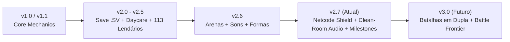

# 🎮 PokeValley Overhaul (v2.7)

[)](https://discord.gg/TycA6bQVMa)
[](https://dotnet.microsoft.com/)
[-brightgreen)](https://www.stardewvalley.net/)
[](https://dotnet.microsoft.com/)
[](#-aviso-legal--propriedade-intelectual)
[](#-arquitetura-clean-room)

> **PokeValley Overhaul** é uma transformação total e nativa do *Stardew Valley 1.6.15*, integrando um sistema completo de RPG Pokémon cobrindo todas as 9 Gerações (1 a 1025), combate clássico por turnos no estilo GBA/NDS com sincronização PvP Lock-Step em multiplayer, reprodução e incubação de ovos, mecânicas agrícolas de Berries e Apricorns, trocas P2P seguras, 113 Lendários com anúncios estilo Pixelmon e todas as gimmicks competitivas (Mega Evolução, Movimentos Z, Dynamax e Teracristalização).

---

## 📢 Comunidade Oficial & Suporte

Junte-se à nossa comunidade no Discord para reportar bugs, sugerir ideias, participar dos testes de novas versões e batalhar contra outros treinadores:

👉 **[Entrar no Discord Oficial do PokeValley](https://discord.gg/VBHfbvQeE3)**

---

## ⚖️ Aviso Legal & Propriedade Intelectual

Este repositório contém **exclusivamente código-fonte aberto** desenvolvido com propósitos de aprendizado, engenharia reversa e interoperabilidade educacional.
* **Nenhum arquivo binário protegido por direitos autorais, ROMs oficiais ou trilhas proprietárias da Nintendo, Game Freak ou The Pokémon Company são distribuídos neste repositório.**
* Todos os recursos gráficos e de áudio são obtidos dinamicamente pelo próprio usuário através de projetos de descompilação comunitária de código aberto ([pret/pokeemerald](https://github.com/pret/pokeemerald), [pret/pokefirered](https://github.com/pret/pokefirered)) e CDNs públicos permitidos através dos scripts de automação.
* Stardew Valley é uma marca registrada de ConcernedApe LLC. Este projeto não possui afiliação comercial com a Nintendo Co., Ltd. ou ConcernedApe.

---

## 🌟 Principais Mecânicas & Funcionalidades (v2.7)

### 1. Pokédex Completa (Gerações 1 a 9 — 1025 Espécies)
* Learnsets canônicos sincronizados por nível e TMs/HMs.
* Sistema completo de Naturezas (+10% / -10% de atributos).
* Cálculo canônico de **IVs (0-31)**, **EVs (até 510)** e **Habilidades Ativas/Passivas** (incluindo Opportunist, Intimidate, Drizzle, Drought, etc.).
* Telas de sumário divididas em abas para leitura de atributos, ataques, IVs/EVs, natureza e medidor de felicidade.
* **Marcos da Pokédex (10% a 100%):** Recompensas desbloqueadas automaticamente pelo progresso de capturas (Exp. Share, Máquina de Cura Portátil, Mega Bracelet, Z-Ring, Dynamax Band, Orbe Tera, Master Balls, Shiny Charm e PC Portátil).

### 2. Motor de Batalha & Arenas Visuais
* Interface retrô inspirada nas telas de combate de Emerald e Platinum.
* Sprites frontais e traseiros animados, partículas de dano, barra de vida dinâmica e tremores de impacto.
* **6 Arenas Temáticas de Fundo:** Adaptação dinâmica do cenário de batalha de acordo com a localização do jogador (Fazenda, Floresta Secreta, Cidade Pelicana, Praia/Oceano, Minas/Caverna da Caveira e Cume da Montanha).
* Condições de status persistentes (**Burn, Poison, Paralyze, Sleep, Freeze**) — com dano sonoro e visual no overworld.

### 3. Batalhas PvP Multiplayer Lock-Step
* Batalhas síncronas entre jogadores no modo cooperativo.
* Seleção de skins de treinador personalizadas (Brendan, May, Red, Ash, Leaf, Ethan, etc.).
* **Segurança de Rede de Nível Enterprise:**
  * Autorização estrita de pacotes (`senderId` verificado contra `OpponentFarmerId`).
  * Tratamento defensivo de dados via `TryParse` e bounds-checking para prevenir exploits e crashes remotos.
  * Bloqueio ativo de injeção de pacotes pelo chat do jogo.

### 4. 113 Lendários, Formas Alternativas & Fusões
* **Encontros & Summons:** Itens de invocação lendários (Flauta do Céu, Orbe Vermelho/Azul, Esferas Adamant/Lustrous/Griseous, etc.) e spawn raro nativo no Vale.
* **Anúncios no Chat (Estilo Pixelmon):** Avisos sutis e atmosféricos no chat quando um lendário surge no Vale (ex: `"[Um Rayquaza rugiu nas altitudes do Vale...]"`) sem alertas centrais invasivos.
* **28 Formas & Fusões Canônicas:** Fusões completas do Kyurem (Black/White via DNA Splicers), Necrozma (Dusk Mane/Dawn Wings via N-Solarizer/Lunarizer), Calyrex (Ice/Shadow Rider), Primal Reversions condicionais e Formas Origin com verificação rígida de itens equipados.

### 5. Daycare, Reprodução & Incubadora
* Sistema de Daycare funcional com verificação de compatibilidade de Egg Groups.
* Geração de ovos com herança de IVs, naturezas (via Everstone) e Egg Moves.
* Incubação em tempo real: passos do jogador diminuem o ciclo de eclosão, com suporte à incubadora do galinheiro e animação clássica de eclosão!

### 6. Sistema de Áudio Clean-Room
* **Cries Canônicos:** Reprodução direta de samples nativos WAV de pokeemerald/pokefirered (Gen 1-3) e arquivos autênticos OGG (Gen 4-9).
* **Músicas de Batalha & Rotas:** Temas clássicos de Wild Battle, Trainer Battle, Gym Leader, Champion e Fanfarra de Vitória com ajuste automático de volume sincronizado com as configurações de som do Stardew Valley.
* **Zero Binários no Git:** Trilha sonora obtida e sincronizada 100% via scripts dedicados.

---

## 🛡️ Arquitetura Clean-Room & Scripts de Instalação

Para garantir conformidade legal estrita (Anti-DMCA), o repositório mantém apenas código C# original e scripts utilitários.

### 1. Sincronização de Áudio Clean-Room
Para baixar e sincronizar todas as músicas e cries oficiais:
```powershell
powershell -ExecutionPolicy Bypass -File scripts\download_audio_assets.ps1
```
*(No Linux ou macOS, utilize `python scripts/download_audio_assets.py`)*

### 2. Sincronização de Sprites Decomp
Para baixar os sprites dos repositórios comunitários `pret/pokeemerald` e `pret/pokefirered`:
```powershell
powershell -ExecutionPolicy Bypass -File scripts\setup_assets.ps1
```

### 3. Compilação Local Direta
Para compilar o código e instalar diretamente na sua pasta da Steam:
```powershell
powershell -ExecutionPolicy Bypass -File scripts\build_local.ps1
```

---

## 🗺️ Histórico de Versões & Roadmap



### 🔹 v2.7 (Versão Atual)
- [x] **Auditoria de Segurança Enterprise:** Validação de remetente em `ACTION`, `SWITCH` e `FORFEIT` no PvP; parsing seguro com `TryParse` e limites de índice.
- [x] **Proteção de Trade & Chat:** Bloqueio de cancelamento por terceiros no Terminal de Trocas e bloqueio de injeção de pacotes pelo chat do Stardew Valley.
- [x] **Arquitetura Clean-Room Total:** Remoção de binários de áudio (`.ogg`/`.mid`) do Git, inclusão em `.gitignore` e criação de `download_audio_assets.ps1` e `.py`.
- [x] **Músicas de Batalha Clássicas:** Reprodução de temas Emerald Wild/Trainer e Red/Blue Wild/Trainer com controle rigoroso de ganho de volume.
- [x] **Marcos da Pokédex (10%-100%):** Recompensas automáticas por percentual de conclusão.
- [x] **Correção de Formas e Itens:** Bloqueio de transformações automáticas sem item equipado (Shaymin, Giratina, Dialga, Zygarde, Rayquaza).
- [x] **UI Debug Polida:** Menu de testes com abas de marcos, limpeza de inventário e ajuste de layout.

---

## 🤝 Como Contribuir

1. Faça um Fork do projeto (`git checkout -b feature/NovaMecanica`).
2. Implemente suas alterações seguindo o padrão de código existente.
3. Certifique-se de compilar sem avisos ou erros (`build_local.ps1`).
4. Abra um Pull Request detalhando as alterações.

Dúvidas e discussões técnicas acontecem diariamente no nosso [Discord](https://discord.gg/VBHfbvQeE3).
