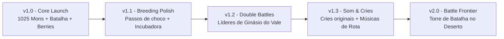

# 🎮 PokeValley Overhaul

[](https://discord.gg/VBHfbvQeE3)
[](https://dotnet.microsoft.com/)
[](https://www.stardewvalley.net/)
[](https://dotnet.microsoft.com/)
[](#-aviso-legal--propriedade-intelectual)

> **PokeValley Overhaul** é uma transformação total e nativa do *Stardew Valley 1.6+*, integrando um sistema completo de RPG Pokémon cobrindo todas as 9 Gerações (1 a 1025), combate clássico por turnos no estilo GBA/NDS, reprodução e incubação de ovos, mecânicas agrícolas de Berries e Apricorns, trocas multiplayer P2P e todas as gimmicks competitivas (Mega Evolução, Movimentos Z, Dynamax e Teracristalização).

---

## 📢 Comunidade Oficial & Suporte

Junte-se à nossa comunidade no Discord para reportar bugs, sugerir ideias, participar dos testes de novas versões e trocar Pokémon com outros treinadores:

👉 **[Entrar no Discord Oficial do PokeValley](https://discord.gg/VBHfbvQeE3)**

---

## ⚖️ Aviso Legal & Propriedade Intelectual

Este repositório contém **exclusivamente código-fonte aberto** desenvolvido com propósitos de aprendizado, engenharia reversa e interoperabilidade educacional.
* **Nenhum arquivo binário protegido por direitos autorais, ROMs oficiais ou sprites proprietários da Nintendo, Game Freak ou The Pokémon Company são armazenados ou distribuídos neste repositório.**
* Todos os recursos gráficos são obtidos pelo próprio usuário através de projetos de descompilação comunitária de código aberto ([pret/pokeemerald](https://github.com/pret/pokeemerald), [pret/pokefirered](https://github.com/pret/pokefirered)) por meio do script de automação fornecido.
* Stardew Valley é uma marca registrada de ConcernedApe LLC. Este projeto não possui afiliação comercial com a Nintendo Co., Ltd. ou ConcernedApe.

---

## 🌟 Principais Mecânicas & Funcionalidades

### 1. Pokédex Completa (Gerações 1 a 9 — 1025 Espécies)
* Learnsets canônicos sincronizados por nível e TMs/HMs.
* Sistema completo de Naturezas (+10% / -10% de atributos).
* Cálculo canônico de **IVs (0-31)**, **EVs (até 510)** e **Habilidades Ativas/Passivas**.
* Telas de sumário divididas em abas para leitura cristalina de atributos, ataques, IVs/EVs, natureza e medidor de felicidade.

### 2. Motor de Batalha (Turn-Based Engine)
* Interface retrô inspirada nas telas de combate de Emerald e Platinum.
* Sprites frontais e traseiros animados, partículas de dano, barra de vida dinâmica e tremores de impacto.
* Retratos nativos dos NPCs de Stardew Valley (Abigail, Pierre, Shane, Harvey, etc.) reagindo com expressões de surpresa e derrota na arena.
* Condições de status persistentes (**Burn, Poison, Paralyze, Sleep, Freeze**) — incluindo som e efeito visual de dano na tela a cada passo do jogador fora de batalha, idêntico aos jogos clássicos!

### 3. Agricultura Especializada (Berries & Apricorns)
* **10 Berries Canônicas:** Oran, Sitrus, Lum, Cheri, Chesto, Pecha, Rawst, Aspear, Leppa e Persim.
* Plantio liberado nas **4 estações** do ano com rega e colheita repetida.
* **Alquimia Culinária no Barril (Keg):**
  * Oran Berry ➔ Potion
  * Sitrus Berry ➔ Super Potion
  * Pecha Berry ➔ Antidote
  * Cheri Berry ➔ Paralyze Heal
  * Rawst Berry ➔ Burn Heal
  * Aspear Berry ➔ Ice Heal
  * Chesto Berry ➔ Awakening
  * Lum Berry ➔ Full Heal
* **Apricorns Coloridos:** Podem ser colhidos de mudas na fazenda, cozidos na fornalha e forjados em Poké Bolas clássicas e especiais (Net, Dusk, Luxury, Heavy, Premier, etc.).

### 4. Sistema de Evolução & Cabo de Ligação (Link Cable)
* Evoluções por nível, por pedras evolutivas (Water, Fire, Thunder, Leaf, Moon, Sun, Shiny, Dusk, Dawn, Ice) e por felicidade alta.
* **Cabo de Ligação (Link Cable):** Permite evoluir monstros de troca (Kadabra ➔ Alakazam, Machoke ➔ Machamp, Haunter ➔ Gengar, Graveler ➔ Golem, Scyther ➔ Scizor, Onix ➔ Steelix) diretamente pelo inventário!

### 5. Estação de Trocas Multiplayer P2P
* Terminal dedicado para troca direta entre dois jogadores no modo cooperativo.
* Ambos selecionam suas criaturas, visualizam a proposta na tela e confirmam simultaneamente para efetuar a transferência e disparar animações de troca.

### 6. Gimmicks Competitivas
* **Mega Evolução:** Ativada em combate com o Mega Bracelet e as respectivas Mega Stones.
* **Movimentos Z:** 18 Cristais Elementais + Ultranecrozium Z exclusivo do Necrozma.
* **Dynamax & Gigantamax:** Transformação gigante com bônus de HP durante batalhas de ginásio e chefes.
* **Teracristalização:** Mudança do tipo defensivo e boost ofensivo usando Tera Shards e o Tera Orb.

### 7. Comandos de Console & Debug
* Por padrão, atalhos de desenvolvedor ficam ocultos para preservar a imersão.
* Digite o comando `/debugPoke` no chat do jogo para liberar o menu de testes via atalho `F8`.

---

## 🌐 Linguagens Suportadas

| Idioma | Interface | Golpes & Descrições | Diálogos |
| :--- | :---: | :---: | :---: |
| 🇧🇷 **Português (Brasil)** | 100% | 100% | 100% |
| 🇺🇸 **Inglês (English)** | 100% | 100% | 100% |

---

## 🛠️ Guia de Instalação via Terminal (Arquitetura Clean-Room)

### Pré-requisitos
1. **.NET SDK 6.0 ou 8.0** instalado ([Download .NET](https://dotnet.microsoft.com/download)).
2. **Git** instalado no terminal (`git --version`).
3. Uma cópia legalmente adquirida do **Stardew Valley 1.6.15+** instalada (Steam ou GOG).

---

### 🛡️ Método 1: Descompilação Local com ILSpy (Recomendado & 100% Anti-DMCA)
Para garantir total conformidade jurídica, este repositório adota o modelo **Clean-Room**: ele não hospeda nem distribui o código-fonte comercial do Stardew Valley. Em vez disso, o script utiliza a ferramenta open-source oficial **ILSpy (`ilspycmd`)** da ICSharpCode para ler e descompilar o `Stardew Valley.dll` legalmente existente no seu computador e aplicar o código do PokeValley:

#### No Windows (PowerShell):
```powershell
powershell -ExecutionPolicy Bypass -File scripts/setup_with_ilspy.ps1
```

#### No Linux / macOS / Steam Deck:
```bash
chmod +x scripts/setup_with_ilspy.sh
./scripts/setup_with_ilspy.sh
```

O script automaticamente:
1. Detecta ou solicita a sua pasta do Stardew Valley.
2. Descompila o jogo localmente via `ilspycmd`.
3. Injeta a camada de código do PokeValley.
4. Faz o download dos sprites públicos dos repositórios decomp comunitários (`pret/pokeemerald`, `pret/pokefirered`).
5. Compila o jogo pronto para jogar!

---

### ⚡ Método 2: Instalação Manual de Assets & Compilação
Caso você já possua uma pasta com a base descompilada:

#### Baixar e Integrar os Sprites dos Projetos Decomp:
```powershell
powershell -ExecutionPolicy Bypass -File scripts/setup_assets.ps1
```

#### No Linux / macOS / Steam Deck:
```bash
chmod +x scripts/setup_assets.sh
./scripts/setup_assets.sh
```

> **Nota:** O script realiza um *sparse clone* apenas das pastas gráficas dos repositórios da comunidade `pret/pokeemerald`, `pret/pokefirered` e `rh-hideout/pokeemerald-expansion`.

---

### Passo 3: Compilar o Projeto
Com os assets organizados, execute a compilação nativa pelo .NET SDK:

```bash
dotnet build "Stardew Valley.csproj" -c Release
```

Os binários compilados serão gerados na pasta `bin/Release/netcoreapp6.0/`.

---

### Passo 4: Instalar no seu Stardew Valley
Copie o arquivo gerado `Stardew Valley.dll` e as pastas de sprites (`pokeemerald/`, `pokefirered/`, `Content/Pokemon/`) para a pasta de instalação do seu Stardew Valley:

```bash
# Exemplo de cópia no Windows
Copy-Item "bin/Release/netcoreapp6.0/Stardew Valley.dll" "C:\Program Files (x86)\Steam\steamapps\common\Stardew Valley\" -Force
```

---

## 🗺️ Roadmap de Atualizações



### 🔹 Versão 1.0 (Versão Atual)
- [x] 1025 Pokémon com learnsets, naturezas, EVs/IVs e habilidades.
- [x] Motor de batalha 1v1 com animações de ataque e retratos de NPCs.
- [x] 10 Berries com ciclo em 4 estações e crafts de poções no Barril (Keg).
- [x] Apricorns com forja de Pokébolas artesanais.
- [x] Evolução por Nível, Pedras, Amizade e Cabo de Ligação (Link Cable).
- [x] Terminal de Trocas P2P entre 2 jogadores.
- [x] Gimmicks: Mega Evolução, Movimentos Z, Dynamax e Teracristalização.
- [x] Efeito e som de dano no overworld por veneno/queimadura ao caminhar.

### 🔹 Versão 1.1 (Próximo Update)
- [ ] Ovos Pokémon compatíveis com a Incubadora padrão de aves do galinheiro.
- [ ] Passos do jogador diminuindo ativamente o contador de passos do ovo no inventário.
- [ ] Registro completo na Pokedex da fazenda com visualizador de habitats por estação.

### 🔹 Versão 1.2
- [ ] Batalhas em Dupla (2v2) em eventos festivos e contra Líderes do Vale.
- [ ] Torneio anual na Feira de Stardew Valley com troféus de batalha.

### 🔹 Versão 1.3
- [ ] Sistema de áudio procedural com os cries digitais clássicos de cada espécie.
- [ ] Trilhas sonoras dinâmicas de rota de acordo com o clima e a estação.

### 🔹 Versão 2.0
- [ ] Fronteira de Batalha no Deserto de Calico (Battle Tower & Battle Factory).
- [ ] Modo Nuzlocke opcional selecionável na criação do save.

---

## 🤝 Como Contribuir

1. Faça um Fork do projeto (`git checkout -b feature/NovaMecanica`).
2. Implemente suas alterações seguindo o padrão de código existente.
3. Certifique-se de compilar sem avisos ou erros (`dotnet build`).
4. Abra um Pull Request detalhando as alterações.

Dúvidas e discussões técnicas acontecem diariamente no nosso [Discord](https://discord.gg/VBHfbvQeE3).
